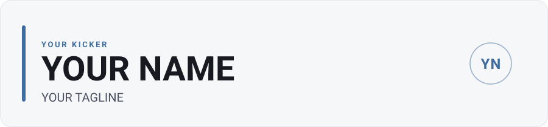

# profile-kit

**A small, reusable kit for a theme-aware, self-updating GitHub profile.**

[](https://drsamonline.github.io/profile-kit/)
[](https://drsamonline.github.io/)
[](https://github.com/drsamonline/profile-kit)
[](https://github.com/drsamonline/profile-kit)
[](https://drsamonline.github.io/profile-kit/)
[](LICENSE)

**Landing page:** <https://drsamonline.github.io/profile-kit/> &nbsp;·&nbsp; **All projects:** <https://drsamonline.github.io/>


Lift it into your own `username/username` profile repo — by hand, or by handing
this repository to an AI agent — and you get a profile page that:

- renders the right artwork and stats card for **light and dark** GitHub themes,
- keeps its **badge counts and project list current** from the GitHub API, on a
  daily schedule, without you editing the README,
- stays **self-contained and offline-first**: inline SVG, no external JS, no
  build step, no service to sign up for.

Built and maintained by [Dr. Sohil Momin](https://github.com/drsamonline) —
see **[All projects](https://drsamonline.github.io/)**.

---

## The three ideas it combines

1. **A theme-aware hero.** A hand-drawn SVG banner served through `<picture>`
   with `media="(prefers-color-scheme: dark)"`, so GitHub shows the light
   artwork on a light theme and the dark artwork on a dark one — no JavaScript,
   just two committed files and the right markup.

2. **A metrics card, rendered twice.** [`lowlighter/metrics`](https://github.com/lowlighter/metrics)
   with the `classic` template, rendered once per theme into
   `assets/metrics-light.svg` and `assets/metrics-dark.svg`. Each render pins its
   own palette through the action's `extras_css` option, because metrics has no
   real light/dark switch (see the known limitation below).

3. **A self-updating README.** A small Python script regenerates the regions of
   the README that sit between HTML comment markers — a row of badge counts and
   a categorised project list — straight from the GitHub API, and a workflow
   commits the result daily. Everything outside the markers is left alone.

Each idea stands on its own; you can take one, two, or all three.

---

## What's in the kit

```
README.md                    this file
assets/hero-light.svg        hero banner template (light)  — edit the placeholders
assets/hero-dark.svg         hero banner template (dark)   — edit the placeholders
metrics.yml                  the metrics workflow           — copy to .github/workflows/
profile-generator/
  update_profile.py          regenerates the marked README regions
  profile-data.json          owner + markers + categories + curated repos
  update-profile.yml         the workflow that runs it daily
  README.md                  how the generator works and how to configure it
docs/                        the kit's own landing page (GitHub Pages, served from /docs)
```

---

## How to use it

### 1. Create your profile repo

Create a public repo named exactly `username/username` (GitHub treats it as your
profile README) and give it a `README.md`.

### 2. Add the hero

Copy `assets/hero-light.svg` and `assets/hero-dark.svg` into your repo's
`assets/` folder, then embed them in the README with a `<picture>`:

```html
<picture>
  <source media="(prefers-color-scheme: dark)" srcset="assets/hero-dark.svg">
  <source media="(prefers-color-scheme: light)" srcset="assets/hero-light.svg">
  
</picture>
```

**Editing the hero.** Both SVGs ship with three visible placeholders —
`YOUR KICKER`, `YOUR NAME` and `YOUR TAGLINE` — plus the two-letter monogram
`YN` in the corner circle. Open **both** files and replace those four strings in
each, and update the `aria-label` / `<title>` at the top of each file (they repeat
the name and tagline for screen readers). Keep the two files byte-for-byte
identical apart from their palette so the light and dark banners line up.

### 3. Add the metrics card

Copy `metrics.yml` to `.github/workflows/metrics.yml`, replace
`YOUR_GITHUB_USERNAME` with your login, and run it once
(Actions → *Metrics* → *Run workflow*). It commits the two SVGs to `assets/`.
Embed them the same way as the hero:

```html
<picture>
  <source media="(prefers-color-scheme: dark)" srcset="assets/metrics-dark.svg">
  <source media="(prefers-color-scheme: light)" srcset="assets/metrics-light.svg">
  
</picture>
```

Read the **Known limitation** below before you expect the languages panel to
show anything.

### 4. Add the self-updating README regions

- Copy `profile-generator/update_profile.py` to `.github/scripts/update_profile.py`.
- Copy `profile-generator/profile-data.json` to `profile-data.json` at the repo root.
- Copy `profile-generator/update-profile.yml` to `.github/workflows/update-profile.yml`.
- Put the four markers in your README:

  ```markdown
  <!-- BADGES:START -->
  <!-- BADGES:END -->

  ...

  <!-- PROJECTS:START -->
  <!-- PROJECTS:END -->
  ```

- Edit `profile-data.json` — set `owner`, keep or change the `markers`, set your
  `categories`, and curate your repos. Run the workflow once to fill the regions.

See [`profile-generator/README.md`](profile-generator/README.md) for the full
configuration reference.

### 5. Turn on GitHub Pages (optional)

The kit's own landing page lives in `docs/`. To publish something similar:
**Settings → Pages → Build and deployment → Deploy from a branch → `main` /
`/docs`**. The `docs/.nojekyll` file tells Pages to serve the files as-is.

---

## Known limitation: the languages panel is empty under `GITHUB_TOKEN`

`lowlighter/metrics` works with the default `${{ secrets.GITHUB_TOKEN }}`, but its
**languages plugin renders empty** because the token is forbidden from reading a
field the base query asks for:

- metrics' base repositories query requests `stargazers { totalCount }`;
- the repository-scoped `GITHUB_TOKEN` is **not permitted** to read that field,
  and the GraphQL call comes back
  `FORBIDDEN: Resource not accessible by integration`;
- that leaves the repositories data unusable, so `plugin_languages` renders
  "0 Languages" with a bare, unstyled "Most used languages" link and no chart;
- **the action still reports success.** There is no failing step and no red X, so
  the card simply looks broken with no error to explain why.

**The fix:** a **classic personal access token with no scopes**, saved as the
secret `METRICS_TOKEN`, is allowed to read `stargazers`. Create one
(GitHub → Settings → Developer settings → Personal access tokens → Tokens
(classic) → Generate new token (classic); no scopes required for public data),
save it as `METRICS_TOKEN`, switch the `token:` input in both render steps to
`${{ secrets.METRICS_TOKEN }}`, and re-enable the `plugin_languages*` lines. The
steps are spelled out at the foot of `metrics.yml`.

**Also worth knowing:** `config_theme` is **not a real metrics option**. It is
copied around the web often, but it silently does nothing. There is no built-in
light/dark switch — light and dark have to be done with `extras_css` and **two
renders**, which is exactly what `metrics.yml` does.

---

## Built with

This profile is assembled from other people's work, and it deserves the credit.

- **[lowlighter/metrics](https://github.com/lowlighter/metrics)** — the rendering engine behind the stats card. It uses the `classic` template with the `base` (header, activity) and `calendar` plugins, and its `extras_css` option to produce a matched light and dark pair from one configuration. Worth knowing: `config_theme` is not a real option and silently does nothing, despite how often it is copied around — light/dark has to be done with `extras_css` and two renders.
- **[avgupta456/github-trends](https://github.com/avgupta456/github-trends)** — the idea of tracking lines of code by language over time, and the pattern of embedding a hosted SVG instead of generating one in the repo. Its embed is parked here until an account is created on their service.
- **[rzashakeri/beautify-github-profile](https://github.com/rzashakeri/beautify-github-profile)** — the catalogue this was worked from. The badge vocabulary comes from its Badges section (the shields.io family), and metrics was chosen from its Widgets list; the busier widgets it also lists (typing SVG, profile trophy, contribution snake) were deliberately left out to keep this page quiet.

---

<sub>Part of **[All projects](https://drsamonline.github.io/)** · built and maintained by [Dr. Sohil Momin](https://github.com/drsamonline)</sub>
